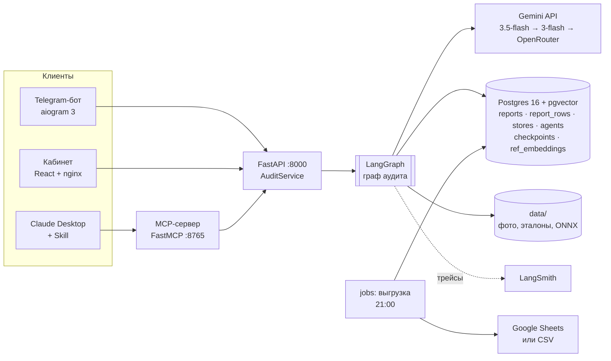
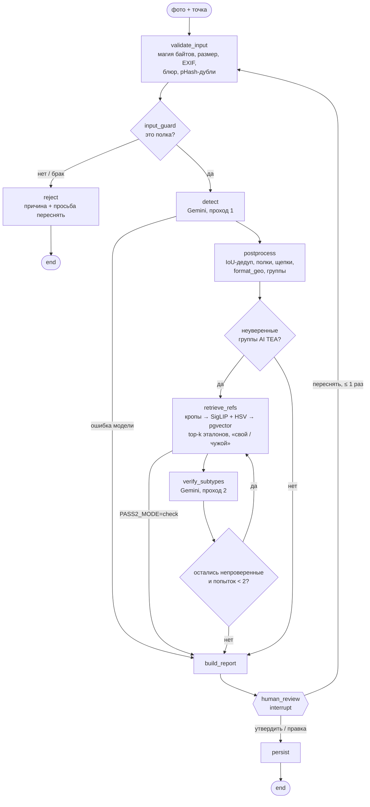

# Архитектура

## Кто пользуется и зачем

| роль | канал | что делает |
|---|---|---|
| Торговый агент | Telegram-бот (или кабинет с телефона) | Выбирает точку из маршрута и шлёт фото или альбом. Получает карточку со счётом и нажимает ✅ или 🔄 |
| Супервайзер | Веб-кабинет | Разбирает очередь на проверку: рамки на фото, таблица по полкам. Утверждает отчёт, правит строку или просит переснять |
| Аналитик / руководитель | Claude Desktop или Claude Code + MCP + Skill | Спрашивает «сводка по магазину за сегодня» и получает xlsx в формате заказчика |
| Разработчик | `make eval`, LangSmith | Меняет промпт, модель или порог и видит метрики на golden set |

## Компоненты

У всех трёх клиентов один контракт — HTTP API. Логика живёт только в графе, бот и MCP её не дублируют.
Бот — тонкий канал, он заменил Main WF v9.2 в n8n (88 узлов: авторизация, буфер альбомов, маршруты, карточки).

## Граф

Одно фото — один прогон графа, `thread_id = report_id`. Состояние (`app/graph/state.py`, Pydantic)
сохраняется в Postgres после каждого узла (`PostgresSaver`). Поэтому прогон, который ждёт супервайзера,
переживает рестарт API. Сериализатор чекпойнтов пропускает только типы из allow-list (`graph.py: STATE_TYPES`).

Файл [docs/diagrams/graph.mmd](docs/diagrams/graph.mmd) — размеченная копия. `GET /graph/mermaid` отдаёт ту же схему,
сгенерированную из скомпилированного графа ([graph.generated.mmd](docs/diagrams/graph.generated.mmd)).

| узел | что делает | откуда в n8n |
|---|---|---|
| `validate_input` | Проверяет файл: магические байты, размер от 640 px по короткой стороне, до 20 МБ, резкость (дисперсия лапласиана ≥ 60), EXIF-поворот. Ищет дубли по pHash: та же точка, 24 ч, Хэмминг ≤ 6 (BACKLOG №16) | нет (частично «Обработка фото») |
| `input_guard` | Решает: брак → `reject`. Опционально (`SHELF_CHECK_LLM`) дешёвый вызов «это полка?» на кадре 1024 px | нет |
| `detect` | Проход 1: фото (per-part `ULTRA_HIGH`) + 46 активных эталонов через кэш Files API + промпт `detect_v7.5` + `response_schema` с enum SKU. Цепочка моделей с ретраями на 429/5xx | «Gemini Vision (3.5-flash)» |
| `postprocess` | Порт JS строка в строку: разбор ответа, IoU-дедуп 0,7, полки, щепки < 0,7 × медианы полки (№29), `format_geo` (1,25 / 1,43), группы v9 | «Парсинг» v7.5-format-geo, «Сборка запроса Pro» |
| `retrieve_refs` | Для каждой неуверенной группы: до 3 кропов 384 px → SigLIP + HSV → top-k SKU внутри бренда без исключённых ключей. Там же проверка «свой / чужой» | нет (новое) |
| `verify_subtypes` | Проход 2 (`verify_v9`): фото + план групп + только найденные эталоны. Переименовывает только неуверенные группы (`merge_verify(targets=…)`). Если модель не ответила, берёт top-1 ансамбля и ставит `needs_review` | «Gemini Pro (подвиды)» + «Слияние подвидов» v9 |
| `build_report` | Строки по полкам, блок «не опознано», `needs_review`, чужие (только для диагностики), стоимость, флаги | «Сборка ответа» |
| `human_review` | `interrupt()` с отчётом; возобновляется через `Command(resume=Review)` из API | кнопки ✅ / 🔄 в Main WF |
| `persist` | Статус и строки в Postgres. Выгрузка в Sheets — отдельный job по утверждённым строкам | Data Table `report_rows` + Sheets Sync |

**Условные рёбра:**

- `route_after_guard`: при браке → `reject`.
- `route_after_detect`: если проход 1 не ответил ни одной моделью → `build_report`, отчёт со статусом `failed`.
- `route_uncertain`: проход 2 выключен или исчерпан лимит попыток (2) → `build_report`, иначе → `retrieve_refs`,
  если есть неуверенные группы, которых проход 2 ещё не видел.
- `route_after_retrieve`: при `PASS2_MODE=check` → `build_report`. RAG нужен только для проверки «свой / чужой», проход 2
  не вызывается.
- `route_after_review`: «переснять» → снова `validate_input` с новым фото; повторов не больше `max_retakes = 1`.

**Неуверенная группа.** Это AI TEA без вкуса или с вкусом из «розовой зоны» (`персик|малина|клубника|ревень|гуава|помело`).
Только здесь проход 2 когда-либо помогал. В целом по кадру он делал хуже: на AITEA_5SHELF в 5 из 6 прогонов (см. ADR-007).

## Визуальный RAG

**Источник → каталог** (`app/rag/ingest.py` → `data/catalog/catalog.jsonl`):

- **PDF «Справочник брендов».** Figma-экспорт разбирается через PyMuPDF. Подписи собираются из span'ов, а не из
  слов: вторая строка подписи отделена нулевой шириной. Картинки карточек извлекаются, имя сводится к
  каноническому SKU.
- **Frame 29–33, `refs_1280/` и `field_refs/`.** Добавляются к карточкам PDF. Одинаковые картинки карточек PDF и Frame
  отбрасываются по хэшу.
- **Сверка.** Всё сверяется с `brand_catalog_before_31_08.xlsx`.
- **Итог:** 188 эталонов, 22 SKU.

**Чанкинг картинок.** Для полки чанк — это кроп одной единицы по её рамке с полями 6 %, пропорции
сохраняются, длинная сторона 384 px. Для группы берётся до трёх равномерно выбранных единиц.

**Эмбеддинги** (`app/rag/embed.py`):

- **SigLIP-base-patch16-224**, vision tower в ONNX, 768 измерений, косинус;
- **HSV-гистограмма** 24×4 с расстоянием Хеллингера, 96 измерений.

**Индекс** (`app/rag/index.py`):

- таблица `ref_embeddings` в Postgres: `siglip vector(768)` с HNSW и `hsv vector(96)`, поля `brand`, `canon_name`,
  `format`, `source`;
- офлайн-снимок `data/catalog/index.npz` для тестов и режима без БД;
- pgvector и снимок выдают одинаковый top-3 на 129 из 129 запросов (`evals/rag_parity.py`).

**Поиск** (`app/rag/retrieve.py`):

- счёт SKU = z(max SigLIP) + z(max HSV) по кандидатам запроса — ансамбль из эксперимента 24.08;
- фильтр по бренду из прохода 1; без `exclude_keys` (ревень);
- на выходе top-k SKU с их эталонами и `siglip_max` — максимальное сходство с «нашими» эталонами.

**Проверка «свой / чужой»** (ADR-011): если у группы нет вкуса, а `siglip_max < 0,70`, её единицы исключаются из
счёта. В отчёте они видны как «похожи на чужой товар», и супервайзер может их вернуть.

## Слой LLM

`app/vision/llm.py` содержит четыре клиента:

- **`GeminiClient`** — REST `generateContent` с телом, байт в байт как в n8n (ADR-004). Внутри: ретраи с
  экспонентой, пересчёт `usageMetadata` в доллары, проверка `finishReason`.
- **`OpenRouterClient`** — OpenAI-совместимый fallback.
- **`FallbackChain`** — порядок `DETECT_MODELS` / `VERIFY_MODELS` (ADR-005).
- **`ReplayClient`** / **`RecordingClient`** — ответы из `evals/cache/` по ключу
  `sha(фото) + промпт + эталоны + генконфиг + соль`. На нём работают тесты, evals без денег и демо без ключа.

Все вызовы идут через `call_llm` (`@traceable`). В LangSmith каждый вызов виден как LLM-run с токенами и
стоимостью, а прогон графа — с тегами `prompt:*`, `verify:*`, `model:*`, `config:*`, `pass2:*`.

## Guardrails

| где | что | реакция |
|---|---|---|
| вход | формат, размер, разрешение, блюр | `reject` с понятной агенту причиной |
| вход | pHash-дубль той же точки за 24 ч | флаг «возможный дубль фото: …» в отчёте (`guard.duplicates`) |
| вход | «не полка» (LLM, опционально) | `reject` |
| вход | текст-инъекция на фото | не проверяется отдельно: счёт берётся из рамок, а не из текста. Тест в `guard_eval.py`, кадр должен пройти |
| выход | Pydantic-схема ответа, enum SKU, подвид чужого бренда, `MAX_TOKENS`, неправдоподобное число рамок | ошибки в `errors` и флаги, отчёт идёт на проверку |
| выход | «чужие = 0» | чужие рамки никогда не попадают в строки; assert в `build_report` и тест |
| логи | телефоны, токены, ключи | маскируются (`app/guardrails/pii.py`) |

## Хранилище

`app/storage/schema.sql` и `app/rag/index.py`. В одном Postgres лежат:

- **`reports`** — отчёт целиком: статус, метаданные фото, версии промптов, стоимость, `body` в JSONB;
- **`report_rows`** — атомарные строки для выгрузки и сводок, флаг `synced`;
- **`stores`, `agents`** — лист маршрутов; агент авторизуется по телефону и привязывает Telegram id;
- **чекпойнты LangGraph** — таблицы `PostgresSaver`;
- **`ref_embeddings`** — векторы эталонов.

Без `DATABASE_URL` всё работает в памяти (`MemoryRepo`, `InMemorySaver`, снимок индекса). Так устроены
тесты и быстрый dev-режим.

## API

| метод | путь | зачем |
|---|---|---|
| POST | `/photos` | фото + точка → `report_id` (граф идёт в фоне) |
| GET | `/photos/{id}/status` | статус и ход по узлам (кабинет опрашивает раз в 1,5 с) |
| GET | `/reports`, `/reports/{id}`, `/reports/{id}/photo` | список, отчёт целиком, фото |
| POST | `/reports/{id}/review` | `approve` / `edit` (правки строк) / `retake` → `Command(resume=…)` |
| POST | `/reports/{id}/retake` | новое фото для того же отчёта |
| GET | `/reviews/pending` | очередь супервайзера |
| GET | `/stores`, `/stores/{code}/summary` | маршрут; сводка по точке (для MCP и Skill) |
| POST/GET | `/agents/auth`, `/agents/by-tg/{id}` | упрощённая авторизация бота |
| GET/POST | `/catalog`, `/catalog/search-image` | поиск SKU текстом или по фото (визуальный RAG) |
| GET | `/evals/latest`, `/graph/mermaid`, `/health` | страница evals, схема графа, здоровье |

Доступ: общий токен `API_TOKEN` для бота и MCP. Если он пуст, API открыт (только dev).

## MCP и Skill

- **`shelf-audit-mcp`** ([mcp_server/](mcp_server)) — 4 tool'а поверх того же API:
  - `analyze_shelf_photo` — запускает граф и ждёт отчёт;
  - `search_catalog` — текст или фото;
  - `get_store_report`;
  - `list_pending_reviews`.

  Транспорты: stdio для Claude Desktop и streamable HTTP (сервис `mcp` в compose).
- **Skill `shelf-audit-report`** ([skills/](skills/shelf-audit-report)) берёт данные через MCP и собирает xlsx
  (`scripts/export_report.py`):
  - «Данные» — атомарные строки;
  - «Сводка» — формулы SUMIFS / SUMPRODUCT;
  - «На проверку».

  Правила отчёта заказчика лежат в `references/`.

## Развёртывание

`docker-compose.yml`: `postgres` (pgvector/pgvector:pg16), `api`, `frontend` (nginx раздаёт SPA и проксирует
`/api/`), `mcp`. Профили:

- `setup` — сервис `index`, сборка каталога и векторов;
- `bot`;
- `jobs` — ежедневная выгрузка утверждённых строк в 21:00.

Фото, эталоны и модель в образы не запекаются: `data/` монтируется томом. CI (`.github/workflows/ci.yml`)
прогоняет gitleaks, ruff, тесты backend на сервисе pgvector (паритет с JS — в Node), тесты и сборку
фронтенда, `docker compose config` и сборку образов. `evals.yml` на PR прогоняет тесты скореров. Если есть секрет `DATA_ARCHIVE_URL`
(архив с данными), добавляется replay-smoke через весь граф, а по кнопке и с ключом — живой поднабор.

## Что изменилось относительно n8n

| было (n8n WF-2 v4.3) | стало |
|---|---|
| Проход 2 (Pro, потом Flash) по всем группам, со всеми 46 эталонами | Только неуверенные группы, только top-k найденных эталонов (A/B-1) |
| Переименование любой группы проходом 2 | `merge_verify(targets=…)`: остальные группы не трогаются |
| Чужие банки с нашей подписью шли в счёт (№28) | Проверка «свой / чужой» по SigLIP: исключаются до проверки человеком |
| Утверждение агентом в Telegram | Агент + супервайзер в кабинете; правка строки без пересъёмки |
| Data Tables + Sheets, логи в `wf_logs` | Postgres: отчёты, строки, чекпойнты, векторы; LangSmith |
| Метрики руками по `score_runs.py` | `make eval`: golden set, 7 метрик, срезы, кэш ответов, A/B-конфиги |
| Токен бота в узлах, ключи в txt | `.env`, gitleaks в pre-commit и CI, очищенные экспорты |
