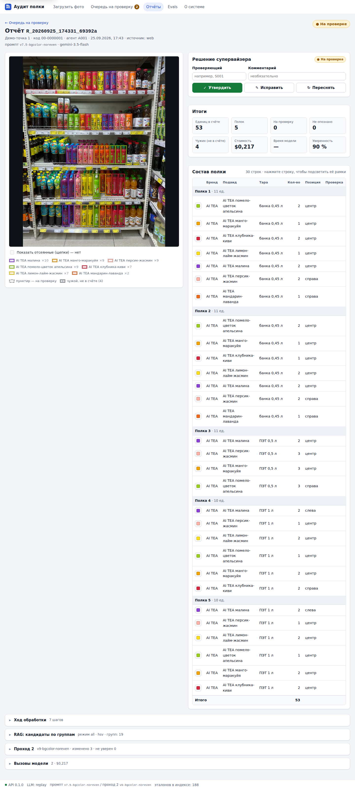
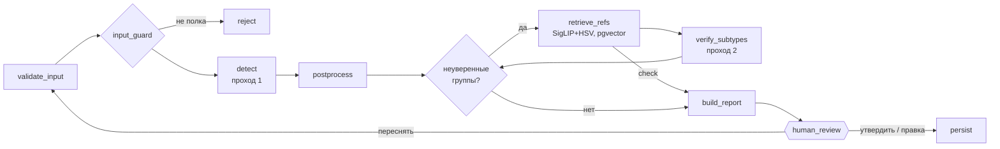
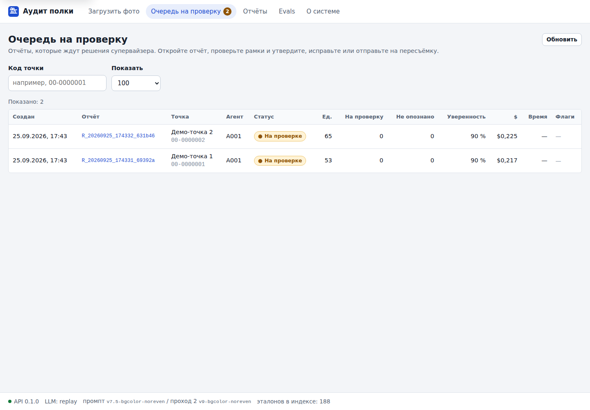
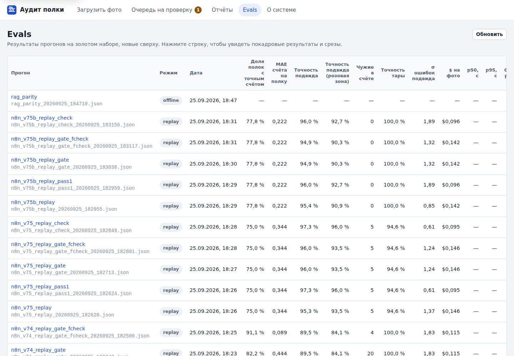
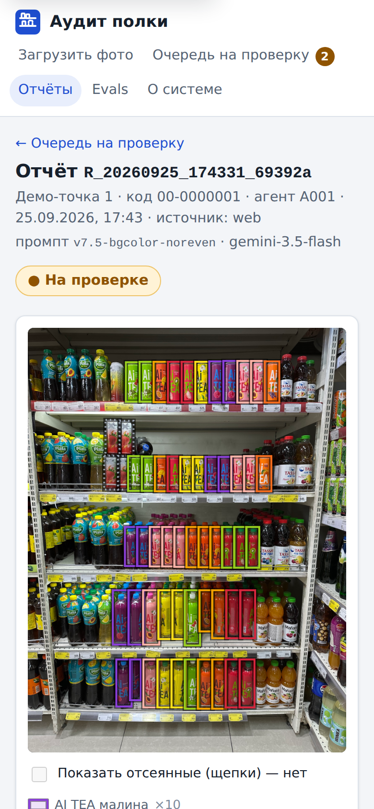

# Shelf Audit — аудит полки по фото

Торговый агент фотографирует холодильник в магазине. Через 1–2 минуты супервайзер видит отчёт: сколько
фронтальных единиц каждого SKU стоит на каждой полке, какая тара, где товар конкурента и в каких местах
модель не уверена. Супервайзер утверждает отчёт, исправляет строку или просит агента переснять.
Утверждённые строки уходят в таблицу, по которой заказчик считает выкладку.

Проект вырос из рабочего бота BURATINO на n8n. Его используют агенты дистрибьютора напитков (бренды
Буратино, AI TEA, Chino, Компотай, Tamga). Для финального проекта nFactorial конвейер перенесён на LangGraph и
дополнен:

- **визуальный RAG по эталонам**: SigLIP + цветовая гистограмма, pgvector;
- **веб-кабинет супервайзера** на React;
- **MCP-сервер и Skill** для Claude;
- **собственный eval-фреймворк** с golden set;
- **guardrails** на входе и выходе.



> ⚠️ Скриншоты и данные содержат фото и бренды заказчика. Репозиторий держим **приватным** до
> письменного согласия заказчика. Сами фото, эталоны и PDF в git не лежат (см. [data/README.md](data/README.md)).

## Что получилось в цифрах

Ниже записанные ответы Gemini из рабочего n8n, прогнанные через новый граф (режим replay, без ключа).
Подробности, срезы и методика — в [EVALS.md](EVALS.md).

| IMG_0644, v7.4, 9 прогонов | было в n8n | новый граф, `gate` (по умолчанию) | новый граф, `check` |
|---|---|---|---|
| Полок с точным счётом | 82,2 % | **91,1 %** | **91,1 %** |
| MAE счёта на полку | 0,44 | **0,09** | **0,09** |
| Чужие банки в счёте (за 9 прогонов) | 20 | **4** | **4** |
| Точность вкуса (позиционно) | 89,3 % | 89,5 % | **90,6 %** |
| $ за фото | 0,115 | 0,115 | **0,075** |

- **`gate`** — второй проход только по неуверенным группам AI TEA и проверка «свой / чужой» по SigLIP.
- **`check`** — только проверка «свой / чужой», без второго прохода. На записанных ответах второй проход вкус не
  улучшает ни в одной из трёх серий, поэтому лучшая рука — `check`. Какой режим оставить по умолчанию, решат
  живые A/B (ADR-007).
- **Промпт v7.5** (цвет фона этикетки) даёт **95–97 %** точности вкуса на IMG_0643/0644: 13 прогонов.
- **Визуальный поиск эталона** находит верный вкус с первой попытки для **96,9 %** из 129 размеченных банок
  (top-1), а среди трёх лучших кандидатов верный есть всегда (recall@3 = 100 %). Эксперимент 24.08 давал 93 %.
- **Стоимость** на gemini-3.5-flash: $0,075–0,096 за фото без второго прохода, $0,115–0,146 со вторым.

Живых A/B на новом ключе ещё нет: конфиги и раннер готовы, запуск — одной командой (см. EVALS.md, «Как запустить»).

## Запуск

Нужны Docker, Python ≥ 3.11 (для скриптов данных хватит 3.10) и `make` (на Windows: Git Bash или WSL).

```bash
cp .env.example .env                                   # ключи: только НОВЫЕ, не боевые
make data ARTYOM="C:/Users/<you>/Desktop/Work/Artyom"  # один раз: фото, эталоны, PDF → data/ (не в git)
make models                                            # один раз: SigLIP ONNX (≈370 МБ)
make demo-up                                           # всё в Docker на записанных ответах, без ключа
```

После этого:

- кабинет открывается на **http://localhost:8080**, API — на http://localhost:8000/docs, MCP — на http://localhost:8765/mcp;
- в demo-режиме граф отвечает записанными ответами на два кадра, IMG_0643 и IMG_0644. Это же запасной вариант на
  случай 429 у Gemini во время защиты.

Тот же запуск с настоящим Gemini: заполнить `GEMINI_API_KEY` в `.env` и выполнить `make up`.

Без Docker:

```bash
make setup
make demo                        # API на :8000, LLM_MODE=replay
cd frontend && npm run dev       # кабинет на :5173
```

Остальные команды:

| команда | что делает |
|---|---|
| `make test-all` | тесты backend, evals, bot, mcp, skill, frontend |
| `make eval-replay` | метрики «до переноса» на записанных ответах n8n |
| `make eval CONFIG=evals/configs/ab1_topk.yaml` | живой прогон; ответы кэшируются |
| `make rag-sanity` / `make guard-eval` | качество поиска эталонов / guardrails |
| `docker compose --profile bot up -d bot` | Telegram-бот (нужен токен нового тестового бота) |
| `make gitleaks` | поиск секретов в рабочем дереве |

Публичного деплоя нет: пока заказчик не согласился, данные нельзя выкладывать наружу. Демо запускается
локально, скриншоты лежат в [docs/screenshots](docs/screenshots).

## Как это устроено

Одно фото — один прогон графа LangGraph, `thread_id = report_id`.

- **Проход 1.** Gemini ставит рамку на каждую единицу и называет бренд, вкус и тару.
- **Постобработка.** Порт узлов n8n строка в строку: IoU-дедуп, полки, отсев «щепок» и тара по геометрии.
- **Неуверенные группы AI TEA.** Это группы из розовой зоны или без вкуса. Их кропы ищутся по эталонам (SigLIP +
  HSV → pgvector). Проход 2 получает только найденные top-k эталонов и правит только эти группы.
- **Проверка человеком.** Граф останавливается на `interrupt` и ждёт решения супервайзера в кабинете или
  агента в боте.



Подробнее: [ARCHITECTURE.md](ARCHITECTURE.md) · решения и альтернативы: [docs/DECISIONS.md](docs/DECISIONS.md) ·
история промптов v0 → v7.5: [docs/PROMPTS.md](docs/PROMPTS.md).

| компонент | стек | где |
|---|---|---|
| Граф, API, RAG, guardrails | Python 3.11, LangGraph 1.x, FastAPI, Pydantic, onnxruntime (SigLIP), PyMuPDF | [backend/](backend) |
| Хранилище | Postgres 16 + pgvector: отчёты, строки, точки, агенты, чекпойнты графа, векторы эталонов | [backend/app/storage](backend/app/storage) |
| Кабинет супервайзера | React 18 + Vite + TypeScript, адаптив до 390 px | [frontend/](frontend) |
| Бот агента | aiogram 3: фото и альбомы → карточка с ✅ / 🔄 | [bot/](bot) |
| MCP-сервер | FastMCP, stdio и streamable HTTP, 4 tool'а | [mcp_server/](mcp_server) |
| Skill для Claude | xlsx-сводка по точке или маршруту в формате заказчика | [skills/shelf-audit-report](skills/shelf-audit-report) |
| Evals | golden set, скореры, раннер, A/B-конфиги, кэш ответов | [evals/](evals), [EVALS.md](EVALS.md) |
| Наследие n8n | очищенные экспорты WF и история промптов | [legacy/](legacy) |

## Скриншоты

| очередь на проверку | итоги evals | телефон |
|---|---|---|
|  |  |  |

Остальные: панели RAG и прохода 2 (`03_…`), схема графа (`06_…`), загрузка (`07_…`).

## Безопасность и данные

- **Боевой контур не тронут.** Боевые n8n, бот, таблица и ключ Gemini в проекте не используются. Все ключи в
  `.env` — новые.
- **Скомпрометированные ключи.** `openai_key.txt` и `openrouter_key.txt` из рабочей папки не копировались, их
  нужно перевыпустить.
- **Проверка на секреты.** Gitleaks стоит в pre-commit и в CI ([.gitleaks.toml](.gitleaks.toml)). Экспорты n8n
  попали в `legacy/n8n/` только после очистки ([legacy/README.md](legacy/README.md)): в старых версиях
  токен бота был прямо в узлах.
- **Данные заказчика.** Фото, эталоны и PDF скачивает `make data` по явному allow-list. В git лежат только GT-JSON и
  записанные ответы модели в виде JSON с рамками.
- **Логи.** Телефоны, токены и ключи маскируются (`app/guardrails/pii.py`).

## Статус

**Проверено:**

- тесты: backend 26 (с Postgres + pgvector), frontend 53, evals / bot / mcp / skill — 8;
- паритет постобработки с оригинальным JS n8n: 33 записанных прогона + случайные входы;
- pgvector и снимок индекса: одинаковый top-3 на 129 из 129 запросов;
- все mermaid-схемы в документах рендерятся (проверено в headless Chromium);
- MCP stdio → API → Skill → xlsx;
- кабинет в браузере на десктопе и 390 px;
- `docker compose config`.

**Не проверено в этой среде:**

- живой Gemini, LangSmith и Telegram (нет ключей);
- `docker compose up` целиком: в среде сборки не было Docker-демона, поэтому сервисы запускались по отдельности
  без Docker;
- срабатывание Skill в Claude Desktop.

Что для этого нужно, перечислено в [docs/TODO_OWNER.md](docs/TODO_OWNER.md).
